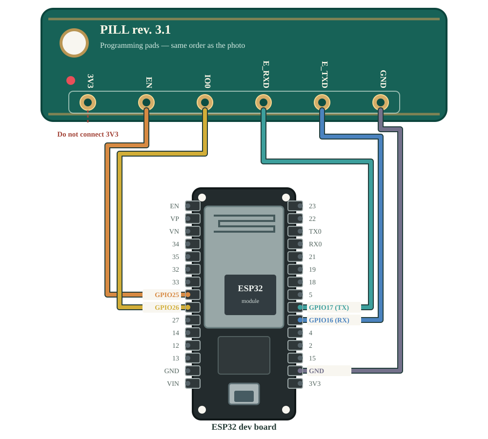

# Initial RAPT Pill conversion

This guide is for the **original RAPT Pill**, including the rev. 3.1 board shown below. It covers the first installation of OpenPill. Once OpenPill is running, later firmware updates can use its BLE OTA service instead of this wired setup.

## Why a bridge is needed

The Pill's USB connector is for charging; the original ESP32 does not expose a USB programming interface through it. The factory firmware also does not have OpenPill's BLE OTA service. For the first conversion, a separate ESP32 development board acts as a **USB-to-UART and boot-control bridge**: your computer talks to the bridge over USB, and the bridge talks to the Pill through five programming connections. The bridge can pull the Pill's `EN` and `IO0` lines low to enter its ROM downloader without driving those lines high.

The conversion tool checks the Pill's chip and 4 MiB flash layout, offers a full recovery copy, writes OpenPill to the **inactive application slot**, reads the new image back to verify it, and only then changes the boot selector. It does not erase the entire flash or replace the Pill's settings partition. The existing RAPT application slot remains available immediately after this first install, although a later OTA update may overwrite that slot. This is still a firmware change with risk: keep a downloaded recovery copy.

## Step 1 — Gather materials and prepare the bridge

You need:

- An original RAPT Pill and its charger/cable.
- An **ESP32 development board** with a USB-to-UART connection. Do not select the Pill as the bridge board.
- A USB **data** cable for the ESP32 development board and a computer with a desktop browser that supports Web Serial, such as Chrome or Edge. Use HTTPS or `localhost`.
- **Five female-to-male jumper wires** suitable for the Pill's programming holes and your development board's pins: one each for `GND`, `E_RXD`, `E_TXD`, `EN`, and `IO0`. Keep the contacts secure so they cannot slip into adjacent pads.

Open the OpenPill web app's `/flash` page (for a local development server, `http://localhost:5174/flash`). With only the development board connected to your computer, choose **Select board and flash bridge**. In the browser's serial chooser, select the board's USB-to-UART adapter. Examples include `COM3` on Windows, `/dev/cu.SLAB_USBtoUART` or `/dev/cu.usbserial-…` on macOS, and `/dev/ttyUSB0` on Linux; its name may include `CP2102` or `CH340`. If unsure, unplug and reconnect the board, then choose the port that appeared. This writes bridge firmware **only to the development board**, replacing whatever was on that board. If it already has the OpenPill bridge firmware, choose **Use an already flashed bridge** instead.

## Step 2 — Connect the Pill

Remove the Pill from its plastic housing. Unplug the ESP32 bridge from USB while making connections. Match the **GPIO labels on your own development board**; physical pin positions differ between ESP32 boards. The Pill's rev. 3.1 header runs left to right as `3V3`, `EN`, `IO0`, `E_RXD`, `E_TXD`, `GND` when viewed as in the [actual wiring example photo](../web/public/pill-programming-pads.webp). On some silkscreens `IO0` looks like `100`.

| Pill hole | ESP32 bridge pin | Why |
| --- | --- | --- |
| `EN` | `GPIO25` | Resets the Pill by pulling `EN` low, then releasing it. |
| `IO0` | `GPIO26` | Selects ROM download mode during reset by pulling `IO0` low. |
| `E_RXD` | `GPIO17` (`TX`) | Data from the bridge to the Pill. |
| `E_TXD` | `GPIO16` (`RX`) | Data from the Pill to the bridge. |
| `GND` | `GND` | Common electrical reference. |

Leave the Pill's `3V3` hole **unconnected**. Do not connect the Pill's `EN` to the bridge board's own `EN` pin; that pin resets the bridge, not the Pill. The UART lines cross by function: the Pill's receive line goes to the bridge's transmit pin, and vice versa. GPIO16/17 may also be marked RX/TX or UART2 RX/TX on a development board.

After checking all five connections, plug the Pill into its charger, reconnect the ESP32 development board to USB, and select **Check connection**. If the check fails, stop and check Pill power, the board's actual GPIO labels, the five contacts, and whether another serial monitor has the USB port open. Do not try to fix a wiring problem by erasing the Pill.

## Step 3 — Save a recovery copy

Choose **Read and save full backup**. The browser reads all 4 MiB, including both application slots and settings, and verifies that the copy was stored in this browser. Download the **Full copy** as a separate file before continuing. Browser storage can be cleared, so it is not your only backup. The file may contain Wi-Fi credentials, account information, and calibration data; store it privately. The two individual slot downloads are optional extras, not substitutes for the full copy.

The page offers **Skip backup**, but skipping means the original firmware and settings may be unrecoverable if something goes wrong. Use that option only if you knowingly accept the loss of a recovery path.

## Step 4 — Install OpenPill

Keep the Pill on its charger and leave both USB and jumper connections undisturbed. In **Install OpenPill**, confirm the backup and charger prompts, then select **Install OpenPill**. The tool verifies the supported Pill and partition layout, writes the new application to the inactive slot, reads it back and checks its hash, updates the OTA boot selector, verifies the selector, and restarts the Pill. It does **not** erase the full flash or rewrite the vendor settings partition.

When installation completes, return to **Your Pills** in the PWA and connect over BLE. Keep the full recovery file. If installation reports a verification or boot-selection failure, follow the on-screen error and the [recovery guide](recovery.md); do not disconnect power or erase flash as a first response.
